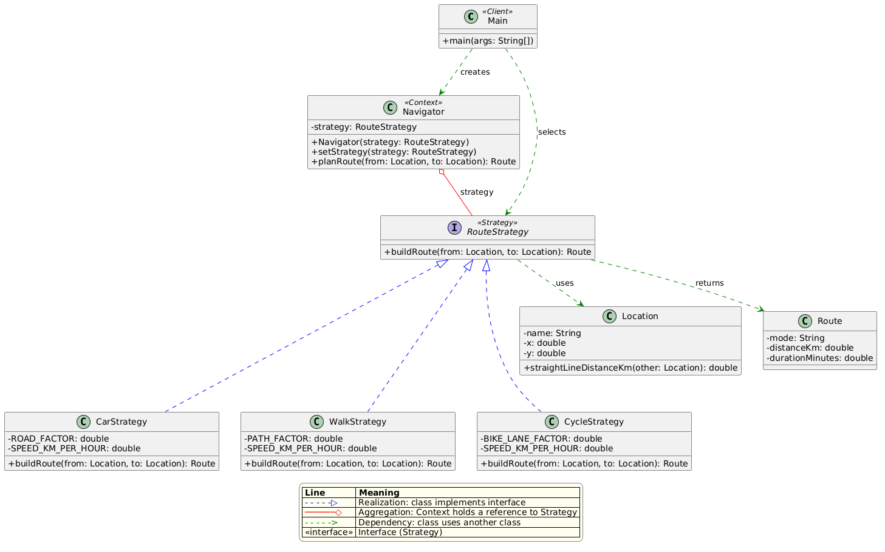

# Assignment #5 — Strategy Pattern

**Course:** ShP-2216 – Software Design Patterns
**Student:** Zhibek Kypshak, SE-2528

## 1. Introduction

The chosen domain is navigation and route planning (Option A). The algorithm family is "how to build a route between two points": by car, on foot or by bicycle. Each variant differs in speed and in how much the real path deviates from a straight line, but all of them answer the same question: what is the route and how long does it take? This makes them interchangeable algorithms behind one common interface, which is exactly the case for the Strategy pattern.

## 2. UML class diagram



The diagram is also available in the repository as `uml.png`.

**Roles in the pattern:**

- `Navigator` is the Context. It holds a reference to a `RouteStrategy` and delegates the work to it.
- `RouteStrategy` is the Strategy interface.
- `CarStrategy`, `WalkStrategy` and `CycleStrategy` are the Concrete Strategies.
- `Main` is the Client. It selects the strategy and passes it to the Context.

**Relationships:**

| Line | Meaning | In this project |
|---|---|---|
| Dashed line with hollow triangle | Realization (implements) | each concrete strategy implements `RouteStrategy` |
| Solid line with hollow diamond | Aggregation (has-a) | `Navigator` holds a `RouteStrategy` |
| Dashed arrow | Dependency (uses) | `Main` uses `Navigator`; strategies use `Location` and `Route` |

## 3. Clean Code principles

### 3.1 Elimination of conditionals in favor of polymorphism

Before:

```java
if (mode.equals("car")) { speed = 60; factor = 1.3; }
else if (mode.equals("walk")) { speed = 5; factor = 1.1; }
else if (mode.equals("cycle")) { speed = 15; factor = 1.2; }
```

After:

```java
return strategy.buildRoute(from, to);
```

The Context contains no `if` or `switch` on the strategy type. The correct behavior is chosen by polymorphism.

### 3.2 Meaningful, intention-revealing names

Names such as `CarStrategy`, `WalkStrategy`, `CycleStrategy`, `buildRoute`, `ROAD_FACTOR` and `SPEED_KM_PER_HOUR` say what the class or constant is, and the unit is part of the name.

Before:

```java
double k = 1.3;
double s = 60;
```

After:

```java
private static final double ROAD_FACTOR = 1.3;
private static final double SPEED_KM_PER_HOUR = 60;
```

### 3.3 Single Responsibility Principle

Each strategy contains exactly one algorithm and nothing else: no user input, no printing, no strategy selection.

```java
public class WalkStrategy implements RouteStrategy {
    @Override
    public Route buildRoute(Location from, Location to) {
        double distance = from.straightLineDistanceKm(to) * PATH_FACTOR;
        double minutes = distance / SPEED_KM_PER_HOUR * 60;
        return new Route("Walk", distance, minutes);
    }
}
```

### 3.4 The Context is algorithm-agnostic

`Navigator` knows only the `RouteStrategy` interface. It does not know the concrete classes or their constants.

```java
private RouteStrategy strategy;

public Route planRoute(Location from, Location to) {
    return strategy.buildRoute(from, to);
}
```

### 3.5 Easy extensibility (Open/Closed Principle)

A new transport mode, for example `BusStrategy`, needs one new class and one line in `Main`. `Navigator` and the existing strategies are not modified.

```java
public class BusStrategy implements RouteStrategy {
    @Override
    public Route buildRoute(Location from, Location to) {
        double distance = from.straightLineDistanceKm(to) * 1.4;
        return new Route("Bus", distance, distance / 25 * 60);
    }
}
```

### 3.6 No magic numbers

All coefficients are named constants declared as `private static final`, instead of bare numbers inside formulas. This makes the formulas readable and the values easy to change.

## 4. Strategy vs. State

Both patterns use composition and delegate work to an interchangeable object, and their class diagrams look almost the same. The difference is in intent. In Strategy, the client chooses the algorithm from outside, the strategies know nothing about each other and never switch one another. In State, the object itself changes its state internally, and the states usually know the next state and trigger transitions. In this project the user explicitly chooses how to travel, and `CarStrategy` never decides on its own to become `WalkStrategy`. The problem is "choose one of several ways to do the same thing", not "behavior depends on the lifecycle of the object", so Strategy is the correct choice.

## 5. Conclusion

The price of the pattern is a handful of small classes (one interface and three strategies) instead of one method full of if/else. In return, the Navigator stays stable, each algorithm is isolated and easy to test, strategies can be switched at runtime, and new transport modes are added without modifying existing code. For a family of algorithms that is likely to grow, this flexibility is clearly worth the extra classes.

## 6. GitHub repository

https://github.com/zhibekkypshak/strategy-navigation.git